# Lab2：BombLab 实验报告

## 1. 实验环境与方法

实验在 Linux x86-64 服务器上完成，通过 VS Code Remote SSH 编辑文件，在终端使用 GCC、Make、objdump 和 GDB。解法写在 `defuser.c` 中，由公共驱动程序传入 challenge 并输出口令。

分析时先用 objdump 查看关卡入口，确定输入整数个数、challenge 的处理方式及被调用函数；再结合 GDB 查看比较操作数、跳转表或节点数据，最后将计算关系写成 C 并测试。下面按关卡顺序记录分析过程。

以下用 `C` 表示 64 位 challenge，`u32(x)` 表示取低 32 位。除对 C 的移位外，下面涉及的整数计算均按 32 位无符号语义进行，加、减、乘按模 2³² 回绕。`^` 表示按位异或。后文公式中的每一步 32 位运算均按上述规则截断，右移采用逻辑右移。

## 2. 第一关：函数调用与参数传递

### 关键汇编与推导

`p1_compute` 将 challenge 的不同部分送入参数寄存器，然后依次调用三个辅助函数。`shr $0x20` 对应右移 32 位，`shr $0x10` 对应右移 16 位，运算结果写入 `edi`、`esi` 等 32 位寄存器时保留低 32 位，同时将对应 64 位寄存器的高 32 位清零。

```asm
# p1_step0
lea (%rdi,%rdi,4),%eax
add %esi,%eax
xor $0xdf27,%eax
# p1_step1
lea 0xd4ba(%rsi),%eax
xor %edi,%eax
# p1_step2
xor $0x9a32,%esi
lea (%rsi,%rdi,4),%eax
```

根据参数传递和返回值的流向，可以恢复为：

```text
lo = u32(C)
hi = u32(C >> 32)
mid = u32(C >> 16)
a = (lo ^ 0x9a32) + 4 * hi
b = (5 * lo + mid) ^ 0xdf27
answer = (a + 0xd4ba) ^ b
```

本关输出一个无符号十进制整数。这里的 `lea` 用于计算乘加表达式，不是读取该地址中的内存。

### 调试记录

使用 seed 43，在 `0x4020e0` 的比较指令处停止：

```asm
cmp %eax,-0x14(%rbp)
```

`p/u $eax` 得到期望值 566112695，`x/1uw $rbp-0x14` 得到输入值 566112695，两者相等。继续运行后输出 `Phase 1 defused.`。

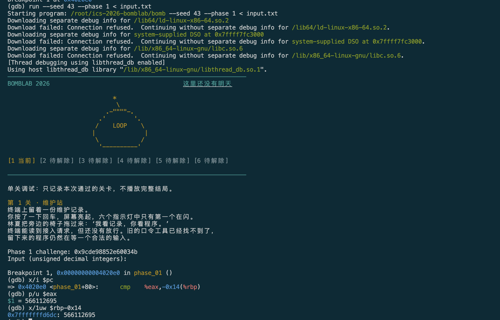

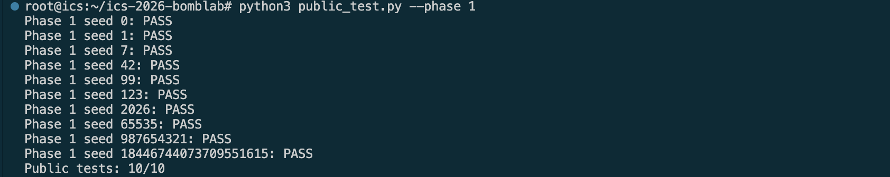

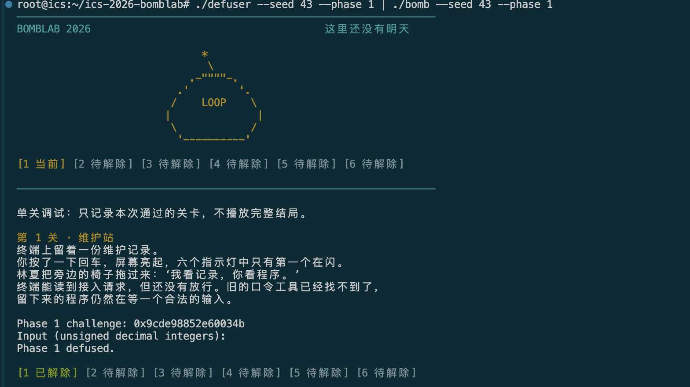

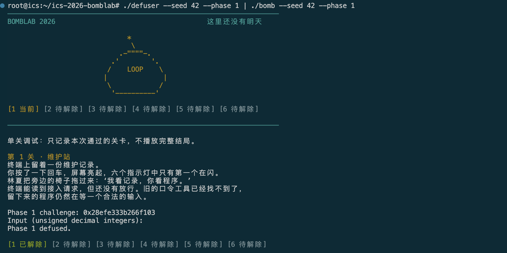

## 3. 第二关：数组、循环与递推

### 关键汇编与推导

输入解析要求六个整数，存放在以 `rbp-0x40` 为起点的数组中。第一个数由以下指令确定：

```asm
shr $0x14,%rax
and $0x3f,%eax
lea (%rax,%rax,2),%eax
```

因此 `v[0] = 3 * ((C >> 20) & 63)`。后面的循环为：

```asm
mov $0x14,%ecx
mov $0x1,%edx
# 循环体
mov %r13,%rax
shr %cl,%rax
and $0x3f,%eax
xor %edx,%eax
lea (%rax,%rsi,4),%eax
mov -0x40(%rbp,%rdx,4),%esi
cmp %eax,%esi
add $0x1,%rdx
add $0x2,%ecx
cmp $0x6,%rdx
```

`rdx` 为下标 i，`ecx` 为移位量。计算期望值时，`esi` 仍保存前一个数组元素。因此：

```text
v[0] = 3 * ((C >> 20) & 63)
对于 i = 1, 2, 3, 4, 5：
    v[i] = 4 * v[i-1] + (((C >> (20 + 2*(i-1))) & 63) ^ i)
```

第一次循环的移位量也是 20，不能误写成 22。最终依次输出六个数。

### 调试记录

使用 seed 43，在 `0x40218a` 比较处观察到 `rdx=1`，`eax=287`、`esi=287`。通过 `x/6uw $rbp-0x40` 读取的数组为：

```text
66 287 1171 4690 18797 75233
```

关闭循环断点后继续运行，第二关通过。

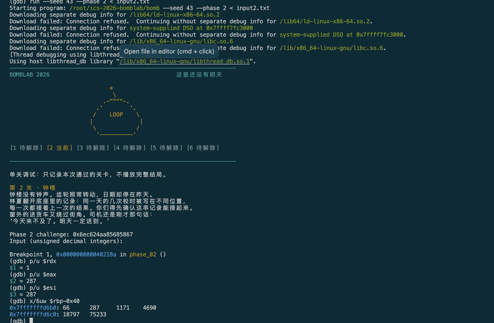

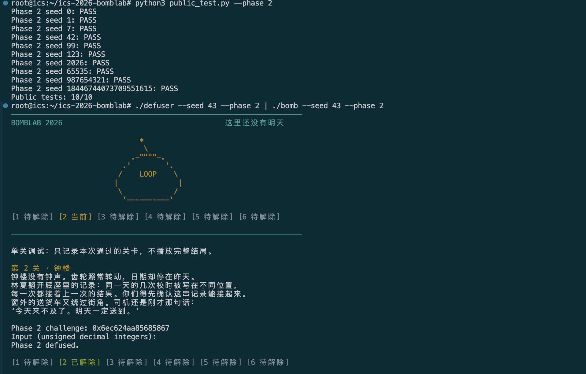

## 4. 第三关：switch 分支与跳转表

### 输入与分派方式

本关要求两个整数，第一个必须等于 `C & 7`。入口函数中：

```asm
and $0x7,%edi
cmp %edi,-0x18(%rbp)
shr $0x3,%rax
shr $0x20,%rsi
xor %eax,%esi
call p3_dispatch
```

因此下标和分支参数为：

```text
index = C & 7
x = u32(C >> 3) ^ u32(C >> 32)
```

`p3_dispatch` 中的间接跳转为：

```asm
mov %edi,%eax
mov %esi,%edi
cmp $0x7,%eax
ja ...
notrack jmp *0x405820(,%rax,8)
```

表项是 8 字节地址。不能按反汇编中各分支出现的顺序猜测下标，需要实际读取跳转表。

### 跳转表与分支计算

使用 `x/8gx 0x405820` 读取表项，并查看各 `p3_case_*` 函数后，得到：

| index | 实际函数 | 第二个输出整数 |
| ---: | --- | --- |
| 0 | p3_case_3 | `5*x + 0x4bec9` |
| 1 | p3_case_5 | `5*x + 0x19799` |
| 2 | p3_case_7 | `(x ^ 0xf0f0) + (x >> 2)` |
| 3 | p3_case_4 | `(2*x) ^ 0xbb73` |
| 4 | p3_case_0 | `3*x + 0x6fd9` |
| 5 | p3_case_1 | `(4*x) ^ 0x1d17` |
| 6 | p3_case_2 | `(x ^ 0x6d05) + (x >> 1)` |
| 7 | p3_case_6 | `5*x + 0xc903` |

例如 `p3_case_6` 的 `lea 0xc903(%rdi,%rdi,4),%eax` 对应 `5*x+0xc903`。

### 调试记录

seed 43 的 challenge 为 `0xd49ffe504bfdab7f`，低三位为 7。在 `0x40224d` 停下后，观察到 `rax=7`、`edi=3722464063`。表项 `0x405858` 指向 `0x402260`，执行两次 `si` 后到达 `p3_case_6`，与表项分析一致。

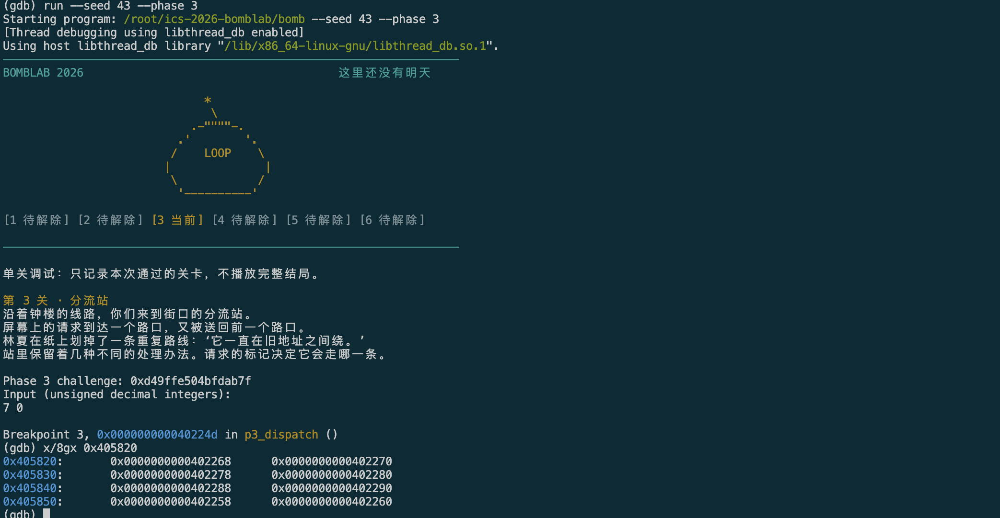

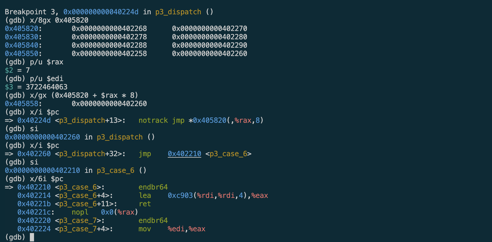

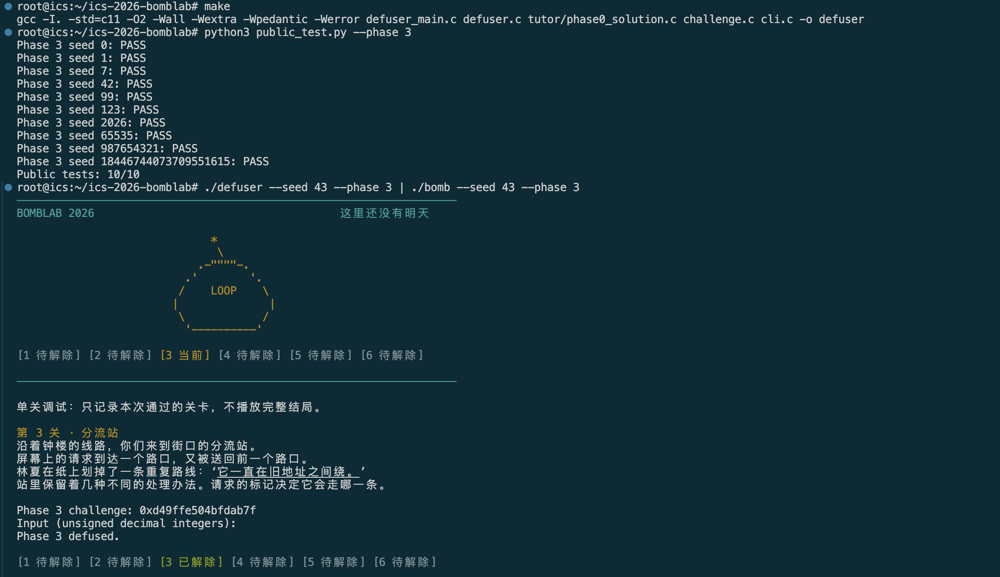

## 5. 第四关：递归调用与返回值组合

### 入口参数

本关要求一个整数。`phase_04` 调用 `p4_walk` 时，四个整数参数依次为：

```text
target = C & 127
low = 0
high = 127
key = u32(C >> 7) ^ u32(C >> 32)
```

### 递归关系

以下指令计算区间中点：

```asm
mov %edx,%edi
sub %esi,%edi
shr $1,%edi
add %esi,%edi
```

即 `mid = low + ((high-low) >> 1)`。随后比较 target 与 mid，选择左半区间或右半区间递归。到达目标时：

```asm
lea 0x9b(%rdi),%eax
xor %ecx,%eax
```

因此递归基例为 `(mid+0x9b)^key`。左右分支在递归返回后都将子结果乘 5，再异或当前层保存的 `mid+key`，最后分别异或 `0x10` 或 `0x18`：

```text
walk(target, low, high, key):
    mid = low + ((high-low) >> 1)
    如果 target == mid：
        返回 (mid + 0x9b) ^ key
    如果 target < mid：
        child = walk(target, low, mid-1, key)
        返回 (5*child) ^ (mid+key) ^ 0x10
    否则：
        child = walk(target, mid+1, high, key)
        返回 (5*child) ^ (mid+key) ^ 0x18
```

这一关最需要注意的是递归返回过程。找到 target 只确定了基例，答案还要经过返回途中每一层的乘法和异或。本关通过静态反汇编恢复递归关系，再用公开测试和额外 seed 验证。

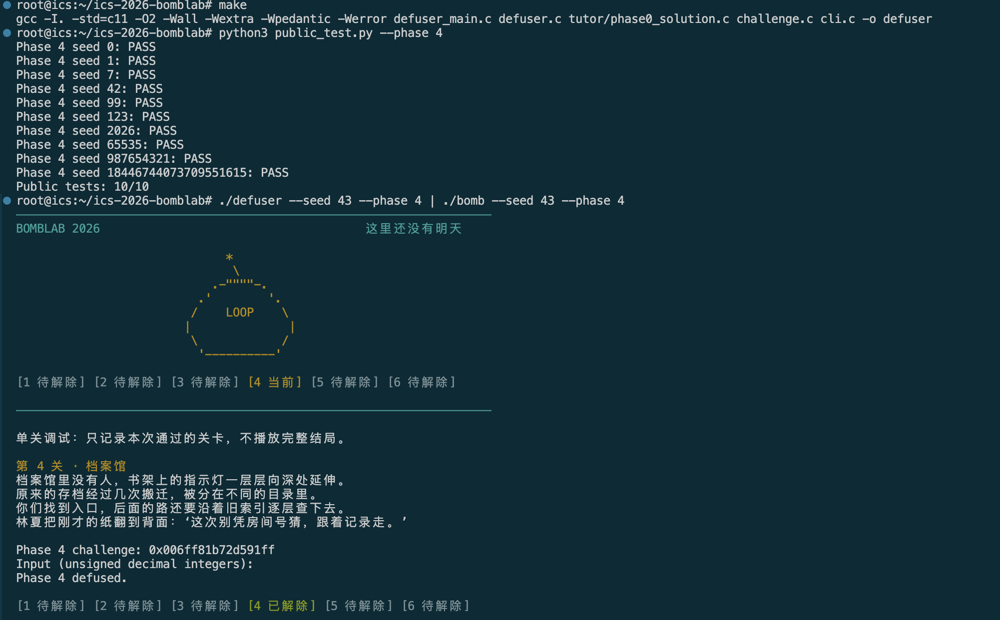

## 6. 第五关：结构体、指针与链表遍历

### 节点布局与数据

`p5_traverse` 从节点偏移 0、4、8 处分别读取两个 32 位整数和一个 64 位指针：

```asm
mov 0x4(%rdx),%esi
xor (%rdx),%eax
mov 0x8(%rdx),%rdx
```

由此恢复节点布局：

```c
struct Node {
    uint32_t value;
    uint32_t id;
    struct Node *next;
};
```

节点大小为 16 字节。头指针表位于 `0x405b60`，节点数组从 `0x405ba0` 开始。用 GDB 读取表和节点，再将指针转换为节点下标：`(地址-0x405ba0)/16`。

| 节点下标 | value | id | next 下标 |
| ---: | ---: | ---: | ---: |
| 0 | 32059 | 2157 | 10 |
| 1 | 22904 | 2320 | 空指针 |
| 2 | 10469 | 1341 | 4 |
| 3 | 48744 | 345 | 8 |
| 4 | 31148 | 2943 | 7 |
| 5 | 19877 | 805 | 0 |
| 6 | 35937 | 1118 | 5 |
| 7 | 11771 | 594 | 11 |
| 8 | 65095 | 1623 | 1 |
| 9 | 58837 | 1815 | 3 |
| 10 | 56827 | 116 | 2 |
| 11 | 7119 | 2657 | 9 |

头指针表对应的节点下标依次为 `6, 5, 0, 10, 2, 4, 7, 11`。

### 计算关系

```text
node = heads[C & 7]
steps = (C >> 3) & 3
acc = u32(C >> 6) ^ u32(C >> 32) ^ 0xdbc6
先处理起始节点：
    acc = (acc ^ node.value) + node.id
随后沿 next 前进 steps 次，每次同样更新 acc。
输出 acc 和最后访问节点的 id。
```

`steps` 是前进的边数，实际访问 `steps+1` 个节点，即使 steps 为 0 也必须处理起始节点。

### 调试与验证

通过 GDB 读取头指针表和节点数据，确认节点字段及 next 指针的对应关系。公开测试达到 10/10，使用 seed 43 验证时输出 `Phase 5 defused.`。

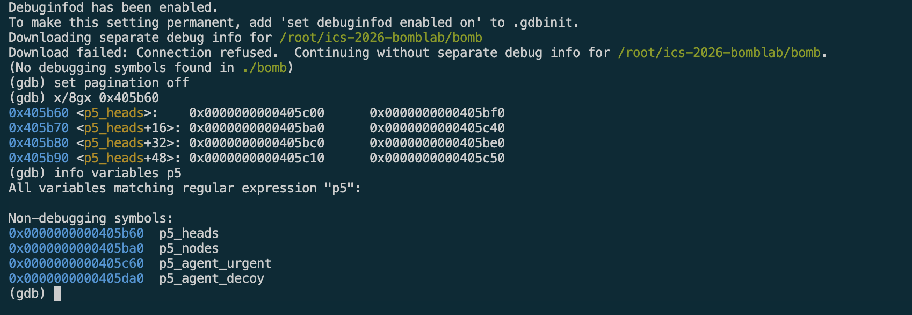

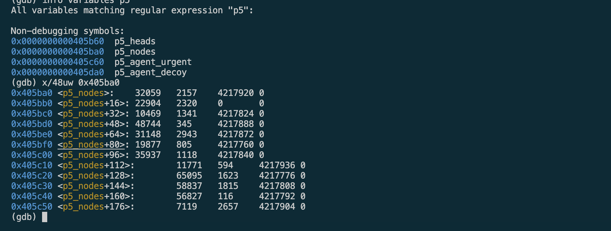

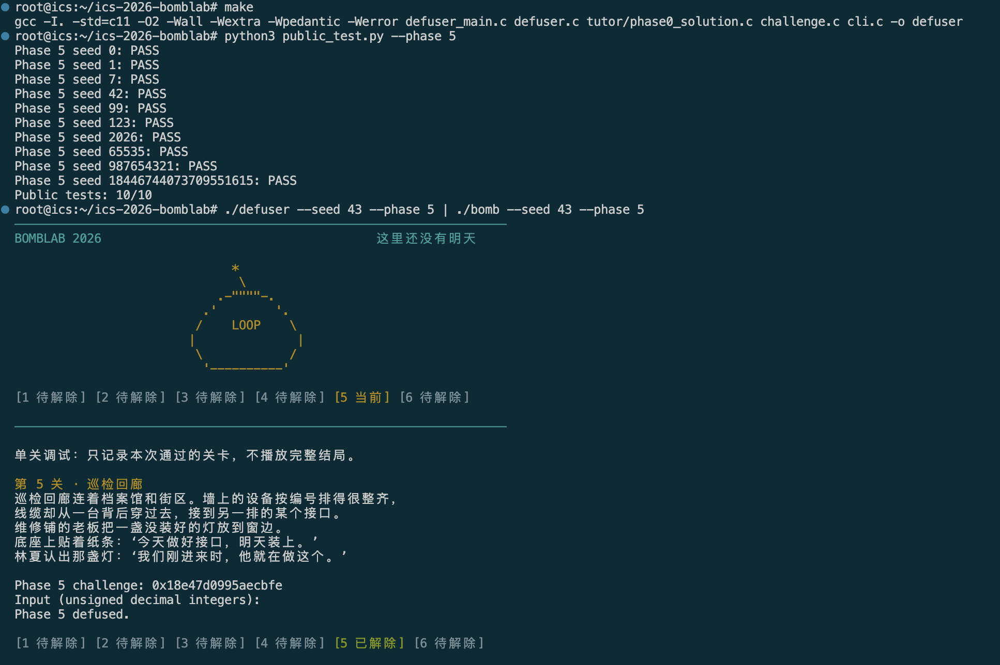

## 7. 第六关：函数指针表与间接调用

### 调用顺序

`p6_dispatch` 中存在两次间接调用：

```asm
and $0x38,%ebx
and $0x7,%eax
call *0x405e00(,%rax,8)
xor $0x29a0,%eax
mov %eax,%edi
call *0x405e00(%rbx)
add $0xa31f,%eax
```

第一次用低三位作为下标；第二次使用 `C & 0x38` 作为字节偏移，等价于下标 `(C>>3)&7` 乘 8。两次调用前后还有固定的异或和加法，不能遗漏。

```text
i = C & 7
j = (C >> 3) & 7
x = u32(C >> 6) ^ u32(C >> 32)
a = table[i](x)
answer = table[j](a ^ 0x29a0) + 0xa31f
```

### 函数表及各操作

用 `gdb -batch -ex 'x/8ga 0x405e00' ./bomb` 读取函数指针表，顺序为：

```text
op_2, op_4, op_5, op_3, op_2, op_0, op_1, op_0
```

| 函数 | 运算 |
| --- | --- |
| op_0 | `rol32(x,5) ^ 0x9aba` |
| op_1 | `(x ^ 0xa229) + 8*x` |
| op_2 | `(x + 0x7259) ^ (x >> 1)` |
| op_3 | `((x >> 3) ^ x) + 0xe4ef` |
| op_4 | `((x << 5) + 0xaf77) ^ (7*x)` |
| op_5 | `ror32(x,7)` |

`rol`、`ror` 是循环移位，移出的位会从另一端补回。因此 C 中分别写成 `(x<<5)|(x>>27)` 和 `(x>>7)|(x<<25)`，其中 x 使用 `uint32_t`。

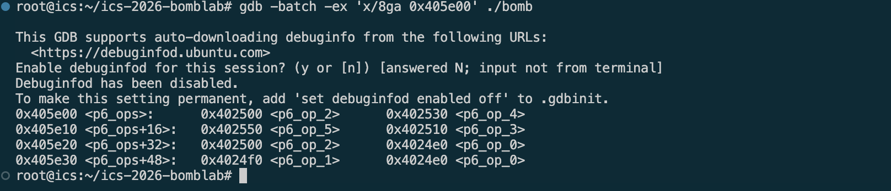

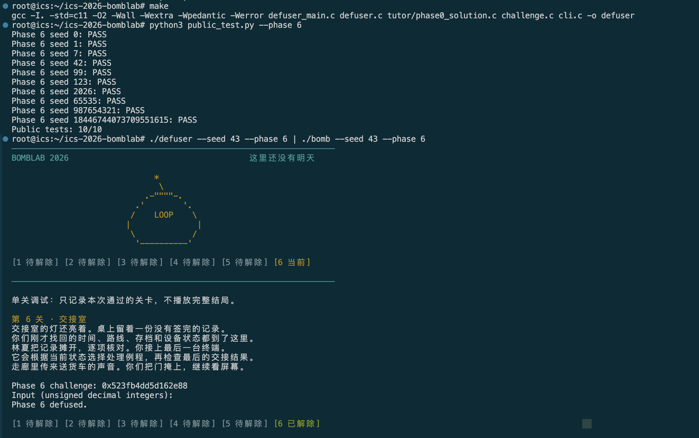

## 8. Honor：相邻字段覆盖与校验

### 入口布局

`secret_gate` 将输入复制到栈上的局部对象中：

```asm
lea -0xd0(%rbp),%r12
call secret_copy
cmpl $0x4e45504f,-0xb0(%rbp)
lea -0xac(%rbp),%rdi
call secret_phase
```

输入起点为 `rbp-0xd0`，标志字段位于 `rbp-0xb0`，相差 32 字节；传给 `secret_phase` 的文本位于起点后 36 字节。`secret_copy` 逐字节复制，直到遇到字符串结尾的零字节。

x86-64 使用小端序，整数 `0x4e45504f` 的内存字节顺序为 `4f 50 45 4e`，即 ASCII 文本 `OPEN`。因此第七行构造为：

```text
32 个 A + OPEN + 三个用空格分隔的无符号十进制整数
```

`OPEN` 后立即接第一个整数。入口的长度检查允许总长度为 36 至 163 字节，这种构造满足长度限制。覆盖发生在同一局部对象的相邻字段中，不需要覆盖返回地址或执行 shellcode。

### 三个整数的恢复

用 C 表示 Honor challenge，K 表示驱动程序提供的 context。`secret_phase` 首先要求第一个整数等于 `K&3`。随后分别折叠 challenge 和 context 的高、低 32 位，并调用 `secret_mix`：

```asm
mov %edi,%eax
ror $0x5,%eax
xor $0x3546,%eax
```

完整关系为：

```text
s = u32(C) ^ u32(C >> 32)
k = u32(K) ^ u32(K >> 32)
a = u32(K) & 3
x = s ^ k
b = ror32(x,5) ^ 0x3546 ^ (a*0xe4d2) ^ u32(K >> 16)
c = b ^ (k + a + 0xd194 + (s >> 5))
```

最终输出前缀及 a、b、c。context 由前六行口令生成，因此 Honor 测试必须同时提供相同 seed 下正确的前六行，不能单独给炸弹输入第七行。

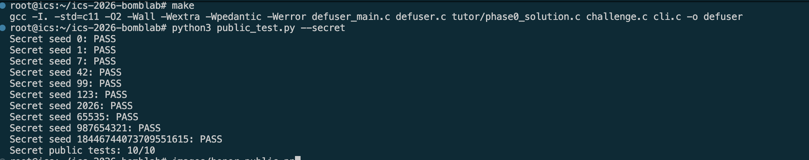

使用非公开seed见下。

## 9. 测试记录

### 公开测试

最终执行：

```sh
make
make test
```

结果为正式六关 `Public tests: 60/60`，Honor `Secret public tests: 10/10`。该结果仅表示公开测试通过，不等同于隐藏测试成绩。

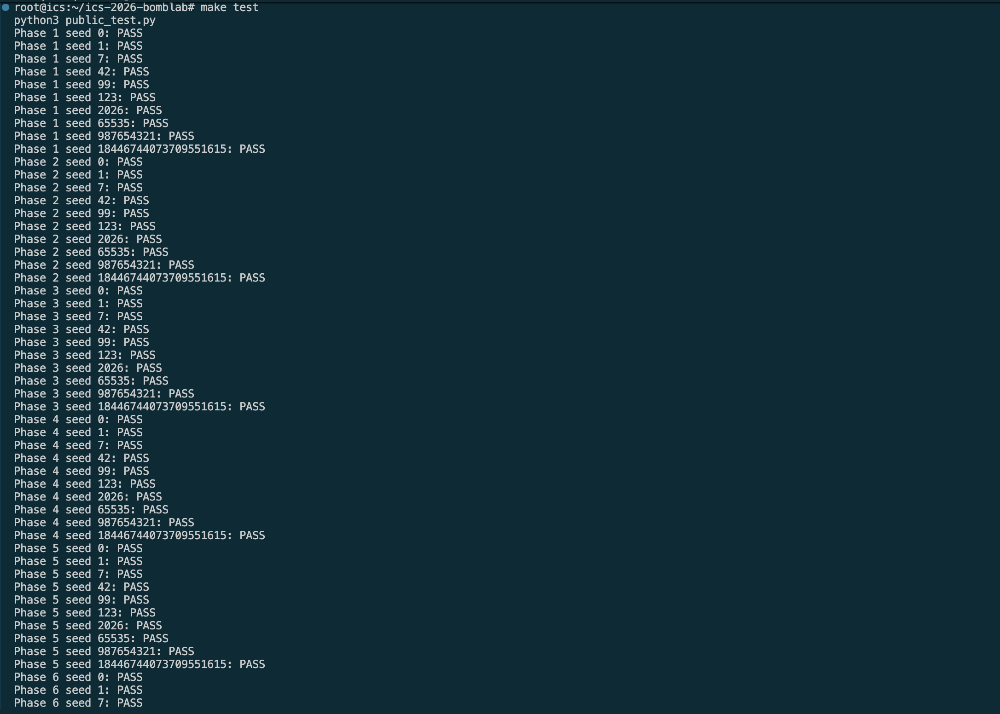

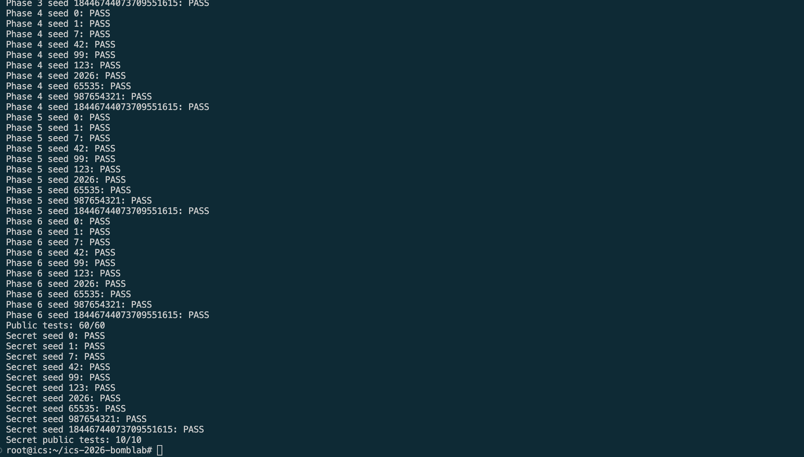

### 非公开 seed 验证

选择不在公开列表中的 seed 43。六个正式关卡均使用 seed 43 进行单关验证，随后用相同 seed 连续验证六关和 Honor。最终使用以下命令对六关和 Honor 连续验证：

```sh
{ ./defuser --seed 43; ./defuser --secret --seed 43; } | ./bomb --seed 43
```

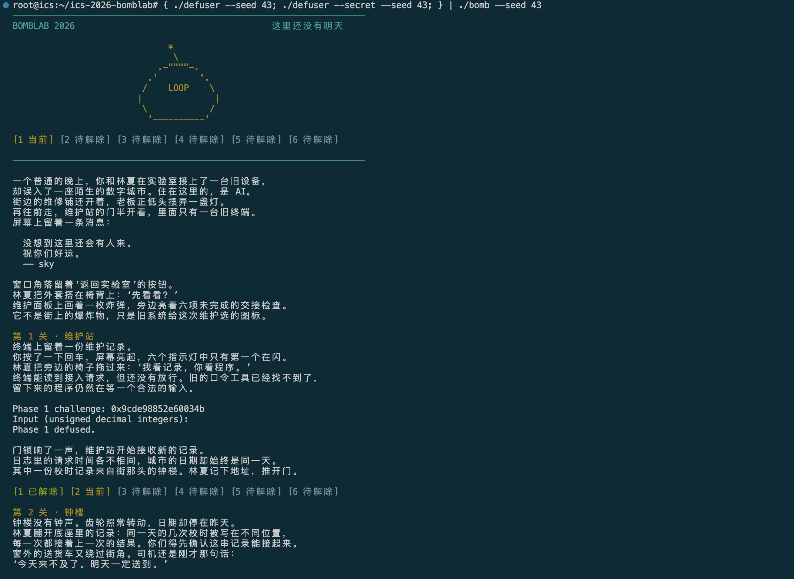

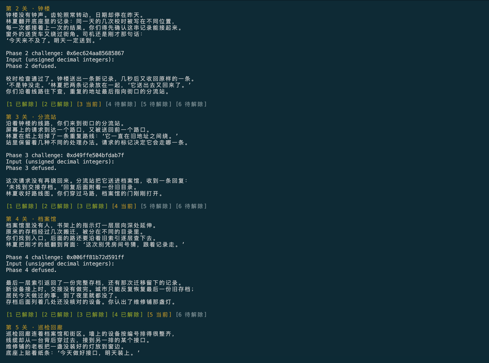

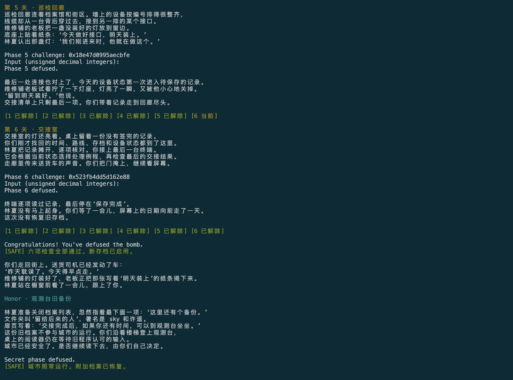

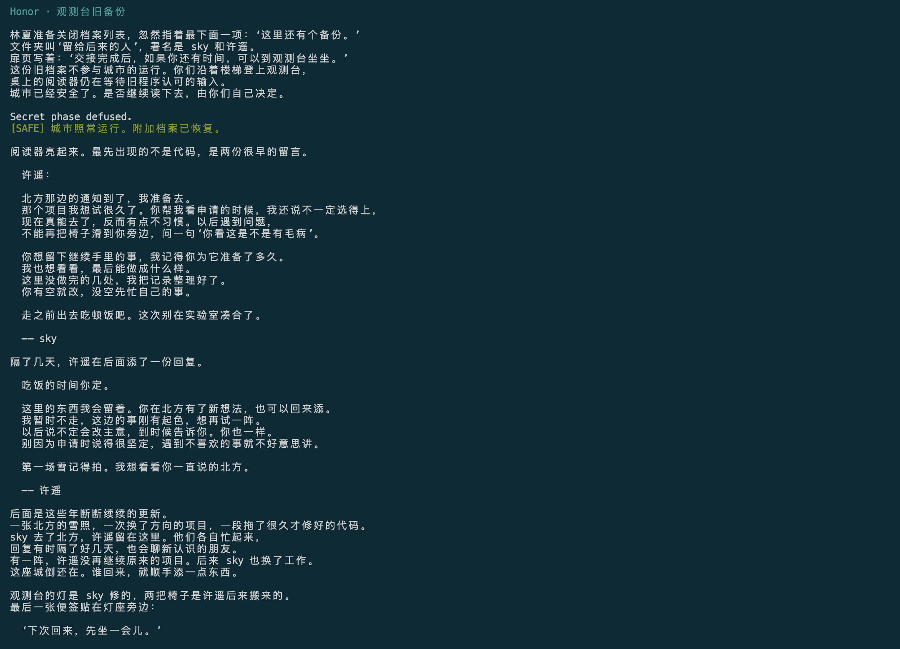

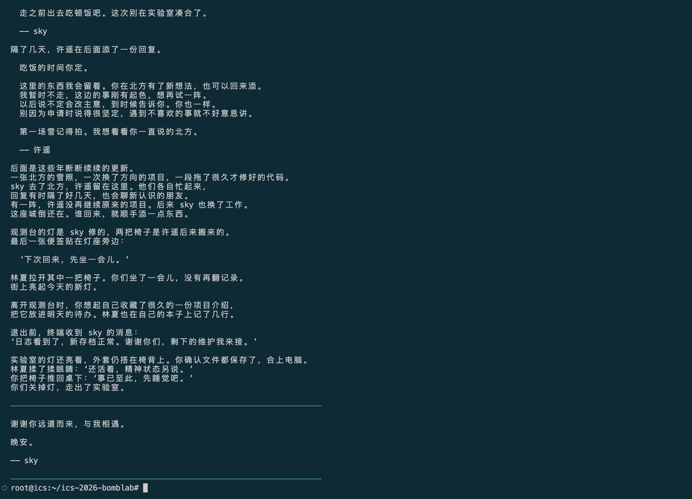

本次额外验证通过，覆盖正式六关和 Honor。

## 10. 实验体会与辅助工具说明

通过这次实验，对汇编中的参数传递、分支跳转、递归返回和指针访问有了更具体的认识。分析程序时，不能只逐条翻译指令，还需要跟踪寄存器的变化，把局部运算串成完整的计算过程。GDB 中观察到的值可以帮助核对推测，但一次通关并不能说明解法对所有输入都正确，还需要结合不同 seed 检查分支和边界。后续仍需加强独立阅读汇编和定位错误的能力，进一步理解 C 代码与机器指令之间的对应关系。

本实验使用 AI 辅助理解汇编指令、C 语言语义及 GDB 操作，核对已有推理、讨论验证方法，并调整报告结构、润色语言。编译、调试和测试在课程服务器上执行，截图来自实际运行。

参考材料：课程提供的《Lab2：BombLab》实验说明、个人炸弹的反汇编、实验模板中的接口和公开测试，以及 CSAPP 第三章有关机器级程序表示、调用约定、控制流和数据结构布局的内容。

